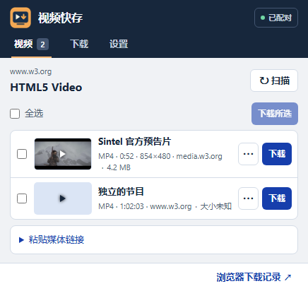

# 视频快存 · VideoSave

[English](README.md) · [下载最新版](https://github.com/KaiserIIII/videosave/releases/latest) · [MIT 许可证](LICENSE)

扫描当前网页上的视频，确认画质和时长，再保存到浏览器的下载目录。视频快存免费开源。Windows 本机服务另外提供 HLS/DASH 下载、格式转换，以及供 AI 调用的 MCP 接口。



## 安装

下载并解压发布 ZIP，里面的 `extension` 是浏览器扩展目录。

| 浏览器 | 安装方式 |
| --- | --- |
| Microsoft Edge | 打开 `edge://extensions`，开启开发人员模式，选择「加载解压缩的扩展」。 |
| Google Chrome | 打开 `chrome://extensions`，开启开发者模式，选择「加载已解压的扩展程序」。 |
| Firefox 136+ 桌面版 | 打开 `about:debugging#/runtime/this-firefox`，点「临时载入附加组件」，选择 `extension/manifest.json`。重启 Firefox 后重新加载。 |
| Firefox 136+ Android（实验） | 解压 `VideoSave-*-android-dev.zip`，按 [Mozilla 的 Android 扩展测试流程](https://extensionworkshop.com/documentation/develop/developing-extensions-for-firefox-for-android/) 加载。常规安装需要签名。 |

在视频页面打开扩展。列表为空时先播放，再点「扫描」。也可以粘贴媒体直链。Android 实验模式会把直链打开到新标签页，保存入口由 Firefox 提供。桌面队列和 Windows 本机服务使用桌面安装方式。当前没有手机版 Chrome 或 Safari 安装包。

## 功能

- 查看片名、时长、分辨率和大小。点击封面静音预览，展开菜单可更换媒体源、改名或复制链接。
- 批量下载并查看进度和速度。浏览器支持时可暂停、继续、取消或重试。支持浏览器默认目录、下载子文件夹和每次询问保存位置。
- 支持跟随系统、浅色、深色、竹青、琥珀主题，以及自定义强调色。
- 配对本机服务后，可保存 HLS/DASH、限制画质、选择 MP4 或 MKV、保留兼容内嵌字幕，或者单独保存视频和 M4A/MP3 音轨。
- 任务并发可设为 1–64，默认 24。满足强 ETag、有效 HTTP Range 和至少 8 MiB 条件的直链可用 4、8 或 12 条连接。符合条件的 HLS 点播也会并行下载分片。

请保存你有权限下载的内容。DRM 视频和未提供可用媒体源的播放器超出当前支持范围。

## 本机服务

在 Windows 安装 Node.js 24，确保 PATH 中有 `ffmpeg` 和 `ffprobe`，然后运行：

```powershell
node tools/server.mjs
```

服务只监听本机，默认地址为 `127.0.0.1:8765`。把命令行显示的地址和配对码填入扩展的「设置 → 本机下载服务」。可通过 `PORT`、`MEDIA_TOOLKIT_TOKEN`、`OUT_DIR` 和 `MEDIA_TOOLKIT_SETTINGS` 修改端口、配对码、默认目录或设置数据库路径。后者默认存到 `%LOCALAPPDATA%/VideoSave/settings.sqlite`。网页探测会启动临时 Chromium 配置，也可用 `BROWSER_BIN` 指定浏览器。

## AI 和 MCP

将下面的路径换成解压后的绝对路径。

```json
{
  "mcpServers": {
    "videosave": {
      "command": "node",
      "args": ["C:/path/to/VideoSave/tools/mcp-server.mjs"]
    }
  }
}
```

MCP 可以独立运行。要共用正在运行的 HTTP 队列，在 MCP 客户端为此进程配置 `MEDIA_TOOLKIT_URL` 和 `MEDIA_TOOLKIT_TOKEN`。两种模式默认使用同一个设置数据库。

| 工具 | 用途 |
| --- | --- |
| `probe_page` | 查看页面、播放器、媒体候选和关联页面。时长由长到短，未知时长在最后。 |
| `start_download` | 下载指定直链或交给服务从页面选片。 |
| `get_progress` / `list_batches` | 查看批次详情或列出当前进程的批次。 |
| `cancel_download` | 取消批次中正在运行或等待的任务。 |
| `get_settings` / `update_settings` | 读取或修改下载默认值和浏览器设置。 |
| `list_downloads` / `open_file` | 查看近期文件或在资源管理器中定位。 |

选正片时，AI 可综合时长、片名和播放器附近的说明。相同的 `player.id` 代表同一播放器，`recommended` 提供播放线索。选好后把确切 URL 用 `kind: "stream"` 交给下载工具。网页文字只用于匹配视频。

将 `{"scope":"download","settings":{"outDir":"D:/Videos","quality":1080,"concurrency":24}}` 传给 `update_settings` 即可修改新批次的默认值。单次任务仍可覆盖默认值。字段设为 `null` 可恢复默认。

用 `scope: "browser"` 可改主题、预览、浏览器子目录、画质等。在已配对扩展中打开「允许本机服务覆盖对应的浏览器设置」后，打开面板或点「立即同步」会读取这些设置。启用期间以本机服务提供的字段为准，需要手动修改时可先关闭同步。

[查看完整 HTTP 接口](README.md#http-reference) · [返回英文首页](README.md)

## 测试

```powershell
node --test tests/*.test.mjs
node tests/smoke.mjs
```

集成测试使用独立浏览器配置、本地测试页和公开样片。下载文件和测试设置使用临时目录。
