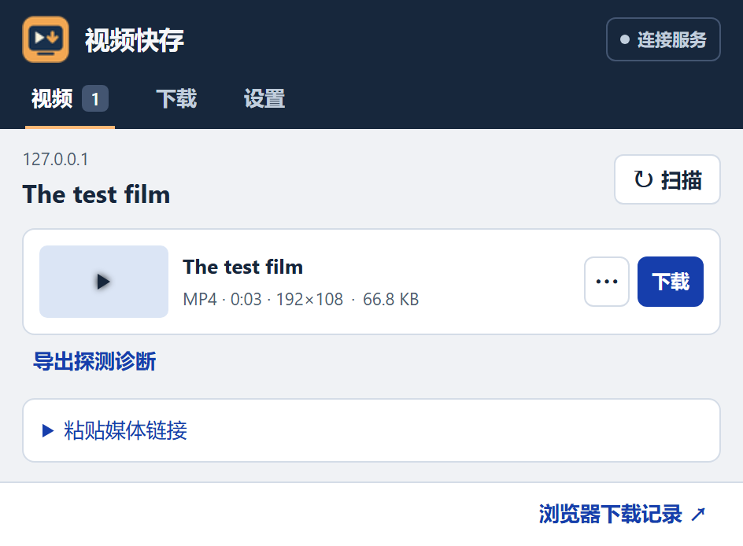

# 视频快存 · VideoSave

[English](README.md) · [下载最新版](https://github.com/KaiserIIII/videosave/releases/latest) · [MIT 许可证](LICENSE)

扫描当前网页上的视频，确认画质和时长，再保存到浏览器的下载目录。视频快存免费开源。Windows 本机服务支持 DASH、更多 HLS 格式、格式转换以及供 AI 调用的 MCP 接口。



扩展的「AI 与 MCP」支持按客户端授权、限时共享当前页、手动授权同源直链媒体使用当前登录会话，以及按站点限制下载。 [托管客户端教程](docs/mcp.md#中文快速开始) · [控制中心截图](docs/videosave-mcp-control.png)

## 安装

下载并解压发布 ZIP，里面的 `extension` 是浏览器扩展目录。

| 浏览器 | 安装方式 |
| --- | --- |
| Microsoft Edge | 打开 `edge://extensions`，开启开发人员模式，选择「加载解压缩的扩展」。 |
| Google Chrome | 打开 `chrome://extensions`，开启开发者模式，选择「加载已解压的扩展程序」。 |
| Firefox 136+ 桌面版 | 打开 `about:debugging#/runtime/this-firefox`，点「临时载入附加组件」，选择 `extension/manifest.json`。重启 Firefox 后重新加载。 |
| Firefox 136+ Android（实验） | 解压 `VideoSave-*-android-dev.zip`，按 [Mozilla 的 Android 扩展测试流程](https://extensionworkshop.com/documentation/develop/developing-extensions-for-firefox-for-android/) 加载。常规安装需要签名。 |

在视频页面打开扩展。列表为空时先正常播放，再打开面板。面板打开期间，播放器、来源或媒体请求发生变化时，列表会更新。也可以粘贴媒体直链，或导出本地探测诊断。Android 实验版会把直链打开到新标签页，可用 Firefox 的保存入口。

[安装与升级](docs/install.md) · [兼容性实测](docs/compatibility-report.zh-CN.md) · [架构](docs/architecture.md) · [MCP](docs/mcp.md) · [隐私](docs/privacy.md) · [更新记录](CHANGELOG.md)

打开「设置 → 备份与更新」可以导出、导入或恢复浏览器设置，也可以查看官方更新。

### Bilibili 和 YouTube

Windows x64 的启动脚本会设置 [yt-dlp](https://github.com/yt-dlp/yt-dlp)，用于保存有下载权限的公开视频。如果手动启动本机服务，先在解压目录运行以下命令。

```powershell
node tools/setup-platform-downloads.mjs
node tools/server.mjs
```

安装脚本会校验固定版本的下载文件并记录来源和校验值。双击启动时，便携工具保存在当前 Windows 用户的 `%LOCALAPPDATA%\VideoSave\tools`。直接运行 `node tools/setup-platform-downloads.mjs` 时，yt-dlp 仍保存在当前解压目录的 `.local-tools`。首次安装 yt-dlp 失败时，本机服务和 MCP 仍可下载直链和媒体流，重新运行安装可启用平台解析。已有自己的 yt-dlp 时，可以在启动本机服务或独立 MCP 前把 `YTDLP_BIN` 设为它的路径。YouTube 解析使用现有的 Node.js。

配对桌面扩展后，打开视频页并扫描，或者直接粘贴视频页链接。画质上限、音视频分离和输出格式仍在下载选项里设置。该入口支持公开、无 DRM 的单条视频，能够显示网页给出的标题和播放时长。目前这个入口只提供封面，动态预览与精确文件大小暂不可用。

AI 调用 `probe_page` 时可从 `downloadTargets` 获取视频页地址、标题、时长和可用画质。把该地址与 `kind: "page"` 一起交给 `start_download` 即可下载。HTTP 的 `/api/probe` 和 `/api/queue` 使用相同字段。

## 功能

- 查看片名、时长、分辨率和大小。点击封面静音预览，展开菜单可更换媒体源、改名或复制链接。
- 批量下载并查看进度和速度。浏览器支持时可暂停、继续、取消或重试。支持浏览器默认目录、下载子文件夹和每次询问保存位置。
- 支持跟随系统、浅色、深色、竹青、琥珀主题，以及自定义强调色。
- 在「设置 → 外观」中切换简体中文和英文，默认跟随浏览器界面语言。
- 桌面浏览器在自动格式下可直接保存兼容的 HLS 点播。设置画质上限后，扩展选择上限以内的最高可用版本。音视频已合并的流保存为 `.ts` 或 `.mp4`。
- 支持按字节范围引用同一个媒体文件的兼容 HLS 清单。视频快存请求所需片段，校验响应范围后再合并。
- 下载使用独立分片地址的 HLS 时，重载扩展会保留已完成的分片。播放清单一致时，队列从未完成的分片继续。
- 配对本机服务可下载 DASH 和带独立音轨的 HLS、降低分辨率、转换为 MP4 或 MKV、保留兼容内嵌字幕，或单独保存 M4A/MP3 音轨。
- 任务并发可设为 1–64，默认 24。满足强 ETag、有效 HTTP Range 和至少 8 MiB 条件的直链可用 4、8 或 12 条连接。符合条件的 HLS 点播也会并行下载分片。

请保存你有权限下载的内容。DRM 视频和未提供可用媒体源的播放器超出当前支持范围。

## 本机服务

Windows x64 用户解压桌面发布包后，双击 `Start VideoSave.cmd`。脚本复用兼容的 Node.js 和 FFmpeg，下载并校验缺少的组件，然后启动本机服务。同一 Windows 用户解压新版本时可直接复用相同版本的便携工具。可以加 `-SkipPlatform` 跳过平台解析器，或加 `-SetupOnly` 只安装并显示 MCP 所需的 Node 路径。

如果自行管理依赖，把 Node.js、`ffmpeg` 和 `ffprobe` 加入 PATH 后运行以下命令。

```powershell
node tools/server.mjs
```

服务只监听本机，默认地址为 `127.0.0.1:8765`。把终端显示的地址和配对码填入扩展的「设置 → 本机下载服务」。用 `Start VideoSave.cmd` 启动的服务重启后会沿用原配对码。手动启动时可使用 `MEDIA_TOOLKIT_TOKEN` 指定配对码，或设置 `MEDIA_TOOLKIT_LOCAL_PAIRING=1` 启用本机配对。通过 `PORT`、`OUT_DIR` 和 `MEDIA_TOOLKIT_SETTINGS` 可修改端口、默认目录和设置数据库路径。数据库默认位于 `%LOCALAPPDATA%/VideoSave/settings.sqlite`。网页探测使用临时 Chromium 配置，也可用 `BROWSER_BIN` 指定浏览器。

在 Node.js 24.14 或更新版本中，Node 下载会使用已配置的 `HTTP_PROXY`、`HTTPS_PROXY` 和 `NO_PROXY`，本机回环连接直连。设置 `NODE_USE_ENV_PROXY=0` 可以关闭自动使用代理。

## AI 和 MCP

Windows 用户可以在解压目录的 PowerShell 中运行下面的命令。启动器会准备依赖，并输出已填入绝对路径的 MCP 配置。

```powershell
& '.\Start VideoSave.cmd' -McpConfig
```

把生成的 `videosave` 条目加入客户端的 `mcpServers`。如果你自行管理运行环境，可以用下面的示例替换为实际路径。

```json
{
  "mcpServers": {
    "videosave": {
      "command": "node",
      "args": ["C:/path/to/VideoSave/tools/mcp-server.mjs"]
    }
  }
}
```

MCP 可以独立运行。要和 `Start VideoSave.cmd` 启动的本机服务共用实时队列，用 `-McpConfig -SharedQueue` 生成配置，并保持本机服务运行。MCP 从本机设置数据库读取配对码，导出的 JSON 不含配对码。如果服务使用自定义配对码，在 MCP 客户端配置 `MEDIA_TOOLKIT_URL` 和 `MEDIA_TOOLKIT_TOKEN`。

| 工具 | 用途 |
| --- | --- |
| `probe_page` | 查看媒体、列表页候选和选片结果。可设 `waitMs`（默认 20000）和 `retries`（默认 2）。 |
| `start_download` | 下载直链，或将 `probe_page` 返回的 `candidates` 直接交给 `items`。 |
| `get_progress` / `list_batches` | 查看批次详情或列出近期批次，包括中断的本地下载。 |
| `wait_for_download` | 等待批次结束。可用 `timeoutMs` 设置等待时间，默认 30,000 毫秒。返回 `timedOut: true` 时下载继续运行。 |
| `cancel_download` | 取消批次中正在运行或等待的任务。 |
| `retry_download` | 沿用当前进程保存的原设置和 Cookie，重试失败和取消的项目。重复提交同一个批次 ID 会返回已有的重试批次。 |
| `get_settings` / `update_settings` | 读取或修改下载默认值和浏览器设置。 |
| `list_downloads` / `open_file` | 查看近期文件或在资源管理器中定位。 |

选正片时，AI 可参考 `selection`、`evidence`、`confidence`、片名和播放器上下文。相同的 `player.id` 代表同一播放器，`recommended` 可能指向自动播放的预告片。探测失败或有多个候选时，读 `diagnostic.code` 和 `diagnostic.nextAction`。歧义页的自动下载返回 `AMBIGUOUS_MEDIA`。选好后把确切 URL 用 `kind: "stream"` 交给下载工具。网页文字是不可信输入。

`selection.status` 为 `unavailable` 时，`reason` 可能是 `no-player`、`no-playlist-request`、`blocked` 或 `timeout`。列表页可直接读取 `candidates`。网页描述默认最多 300 字符，并标记 `pageContext.untrusted: true`。设置 `includeText: true` 可获取完整描述。HLS 主清单或播放器有多套画质时，流可附带 `quality: [{height, bitrate, url}]`。含独立音轨的 HLS 可把主清单 URL 与所选 `quality` 上限交给下载工具。

`probe_page` 可用 `mode: "headed"` 在隔离的 Edge 或 Chromium 窗口中观察页面，`waitForMediaMs` 可设置单次媒体观察窗口（最长 60 秒）。`clickPlay: true` 尝试启动唯一可见的播放器。`includeFrames: true` 纳入内嵌播放器及其 `frameUrl`。`captureXhrBody: true` 检查播放器同源 JSON 的 `sources` 列表（最多 50 条，每条最多 512 KiB），用 `discoveredBy: "xhr-json"` 标记来源，未找到时以 `xhrJson` 返回键名和命中数。检测到挑战、验证码、HTTP 402 或浏览器 DRM 时会返回 `blockers`。

`maxSec` 默认按需读取远程媒体。显式传入 `prefetch: true` 会先尝试预取完整源，再截取输出。结果的 `prefetch` 表示是否使用了预取文件，回退时会记录 `prefetchFallback.reason`。显式 `headers` 优先于同一服务进程近期观察到的同一媒体地址的请求头。HLS 预取收到 429 时，单项状态提供 `RATE_LIMITED` 和 `detail.retryAfterSec`。能识别出到期时间的地址提供 `expiresAt`。流复制的截取位置受媒体包边界影响，以返回的 `info.duration` 为准。

`start_download` 的可选 `headers` 支持 `Referer`、`Origin` 和 `User-Agent`。预取和远程 FFmpeg 读取会使用这些请求头。Cookie 仍由 `cookie` 单独传入。

要让 DSH 等 MCP 客户端用 8 路连接保存完整 HLS 点播，向 `start_download` 传入下列参数，并用探测到的清单地址替换示例 URL。

```json
{"items":[{"kind":"stream","sourceKind":"m3u8","url":"https://example.com/video.m3u8"}],"prefetch":true,"connections":8}
```

把返回的批次 `id` 交给 `wait_for_download`。如果返回 `timedOut: true`，用同一 ID 继续等待。完成后看每项的 `status` 和 `outputs`。如果 `prefetch` 为 `false`，查看 `prefetchFallback.reason` 判断为何回退。

将 `{"scope":"download","settings":{"outDir":"D:/Videos","quality":1080,"concurrency":24}}` 传给 `update_settings` 即可修改新批次的默认值。单次任务仍可覆盖默认值。字段设为 `null` 可恢复默认。

用 `scope: "browser"` 可改主题、预览、浏览器子目录、画质和界面语言。语言字段 `language` 接受 `system`、`en` 或 `zh-CN`。在已配对扩展中打开「允许本机服务覆盖对应的浏览器设置」后，打开面板或点「立即同步」会读取这些设置。启用期间以本机服务提供的字段为准，需要手动修改时可先关闭同步。

[查看完整 HTTP 接口](README.md#http-reference) · [返回英文首页](README.md)

批次终态为 `done`（全部成功）、`partial`（部分成功）、`failed`（全部失败）或 `cancelled`。进度包含 `active`、`queued`、`failed` 和最多 5 条日志。每项返回 `percent`、`speed`、`bytes`、`totalBytes` 和 `etaSec`。大小或剩余时间无法确定时对应字段为 `null`。

本地下载进程重启后，`resumable: true` 表示可以继续原批次。用 `start_download` 重新发送原请求，包括原设置和所需 Cookie。已完成的项目仍计入该批次。清单和密钥一致的按分片 HLS，以及通过强 ETag 校验的直链 Range 下载，可以复用已完整写入的分片或范围。中断的单连接传输、DASH 和平台提取任务会从头下载该项。若决定放弃，可用 `cancel_download` 清理中断批次的暂存文件。

成功项的 `outputs` 提供本地路径及 ffprobe 核验后的 `info`，包括时长、大小、编解码器和容器。请求保留字幕时返回 `subtitleTracks`，包括 0 条。失败项提供 `errorCode` 和经过脱敏的 `detail`。批次的 `lastError` 是最近一次单项失败。`open_file` 只允许在已配置的下载目录中定位媒体文件。

## 开发与打包

在源码目录运行以下命令。测试使用 Node.js 24、Edge 和 FFmpeg。打包只需 Python 3.9+ 的标准库。

```powershell
node --test
node tests/smoke.mjs
python tools/build_release.py
```

完整测试使用隔离的浏览器配置和公开样片。用 `node tests/smoke.mjs --delivery-only` 可只用本地测试素材验证配对和下载。打包会在 `dist/` 生成桌面 ZIP、Android 开发版 ZIP 和 SHA-256 校验值。
