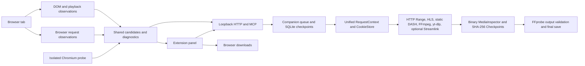

# VideoSave architecture

### Core v1.0.0 Companion Modules

- `tools/request-context.mjs`: Centralizes sanitized `Referer`, `Origin`, and `User-Agent` across Master/Media playlists, init/media segments, byte ranges, separate audio/subtitle tracks, authorized AES-128 keys, retries, resume, bounded URL refresh, and FFmpeg fallback (including host+port scoped `-cookies`), strictly preventing cross-origin credential leakage.
- `tools/media-inspector.mjs`: Validates actual container bytes (MPEG-TS, ID3-prefixed TS, M2TS, custom-prefixed TS, fMP4/ISOBMFF, WebVTT, AES-128 post-decrypt plaintext) independent of URL extensions or MIME types while rejecting real images, HTML/JSON/XML error pages, corrupted payloads, and DRM boxes.
- `tools/quality-negotiator.mjs`: Deterministic variant selection across HLS/DASH (`best`, `max`, `auto`, `lowest`, height caps, `exact:HEIGHT`, bitrate/byte budgets, SDR/HDR preference) without guessing unverified URLs.
- `tools/cookie-store.mjs`: Unified Netscape `cookies.txt` and `Cookie:` header parser with challenge-cookie rejection and memory-only TTL sessions that never echo secrets to AI models.
- `tools/browser-sessions.mjs` & `tools/edge-session.mjs`: Manages dedicated VideoSave-isolated Chromium profiles (`profileMode: "dedicated"`, `browserSessionId`, custom `userAgent`, `browser`, `browserBinary`, `proxy`) with graceful CDP shutdown and zero access to system browser profiles.
- `tools/streamlink-adapter.mjs`: Optional verified local `STREAMLINK_BIN` adapter exposing capability detection without weakening HTTP 403/401/451 access boundaries.

`extension/media.mjs` harvests DOM evidence and merges observations by HTTP(S) resource. `media-adapters.mjs` recognizes explicit source arrays and schema.org VideoObject metadata. It processes a bounded stack of public JSON and ignores unknown schemas. Add a supported schema there and exercise the expected candidates in the compatibility fixtures.

`manifest-evidence.mjs` relates adaptive manifests, renditions and initialization resources. It never offers blob URLs as downloads. `detection.mjs` records the signals used to rank a candidate and reports ambiguity or blockers. It also defines the diagnostic export allowlist. A playing element is a weak signal by itself because it can be a trailer. Where evidence supports the legacy duration rule, the API retains its existing selection reason.

The extension listens to request metadata through its existing browser permissions. Content observers run in the isolated world while the panel is active. They coalesce playback and source changes and expire after a bounded interval. The extension can inspect a bounded public manifest or recheck a small set of same-origin player JSON endpoints observed by the browser. These reads omit credentials and reject redirects. MCP observes CDP response metadata and optionally inspects same-origin JSON response bodies. Both surfaces preserve access restrictions and leave normal site authorization to the user.

Windows workers use the requested connection count as their per-transfer ceiling. Range prefetch verifies ETags and offsets. HLS prefetch retries transient segment failures and bounds duplicate requests from spare workers. Local queue recovery preserves completed outputs and revalidates checkpoint inputs before resuming. FFprobe verifies output tracks and duration where available.

The managed MCP tools use a profile-scoped credential on the paired loopback server. The extension confirms the identity of the approved document and periodically renews the grant. Optional login credentials apply to the exact approved same-origin direct resource. The owner can authorize related CDN playback. The companion validates target URLs and resolves public CDN addresses at connection time. Redirects require exact playback evidence. Managed jobs stage direct media, eligible HLS, or static DASH before passing a local file to FFmpeg. SQLite stores policy, audit metadata, and batch ownership.

Standing approvals are attached to a client and exact origin. Their download permission also applies when the site owner has enabled manual downloads. The browser binds live grants to a document and tracks shared cookies by exact hostname and browser store. A stable local fingerprint covers cookie changes before media appears. Candidate refresh preserves IDs for unchanged sources. New signed URLs receive new IDs once observed. Private clients keep new managed batch state in memory.

The standalone Maximum Compatibility plan divides the observation budget among discovery stages. Its second stage inspects embedded frames and public JSON if the first misses. Adaptive can start with a recent successful strategy. The optional local rule store keeps strategy preferences and aggregated probe outcomes by origin. Recommendation thresholds account for unsuccessful samples and learned recommendations expire after an inactive month. Imported preferences are explicit overrides.

See [compatibility evidence](compatibility-report.zh-CN.md), [MCP operations](mcp.md), [installation](install.md), and the [privacy policy](privacy.md).
